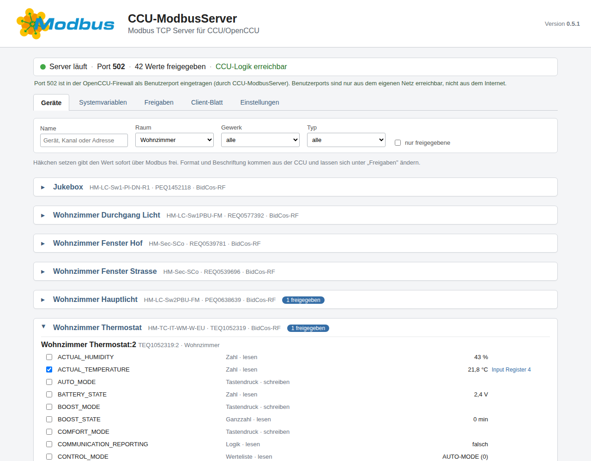
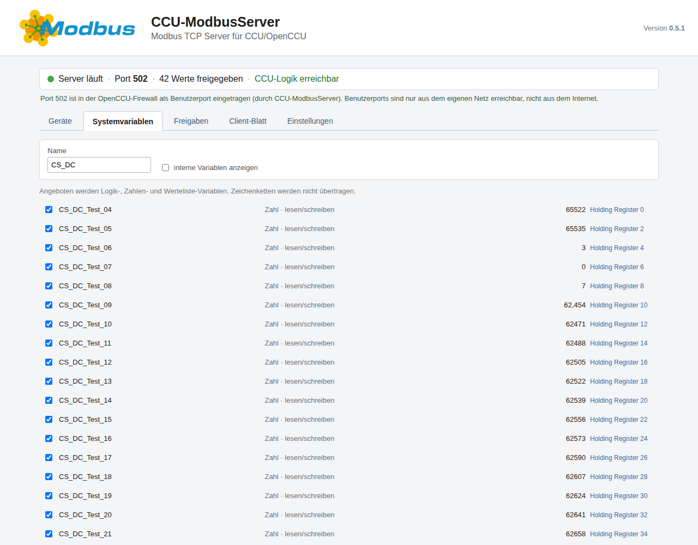
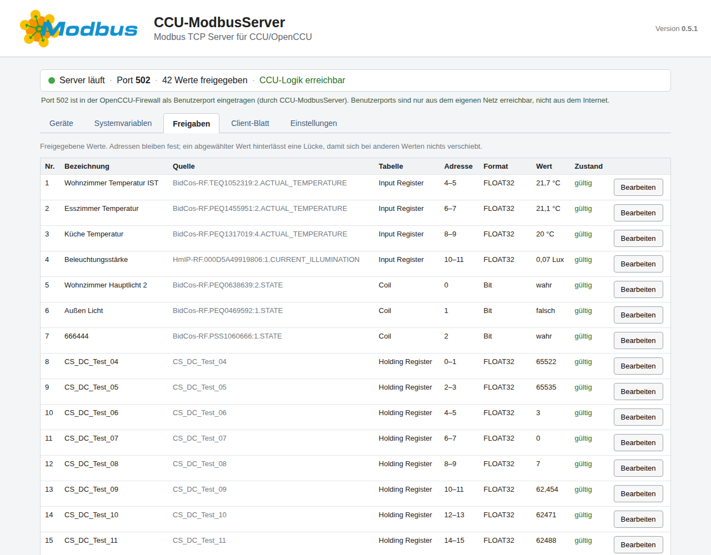
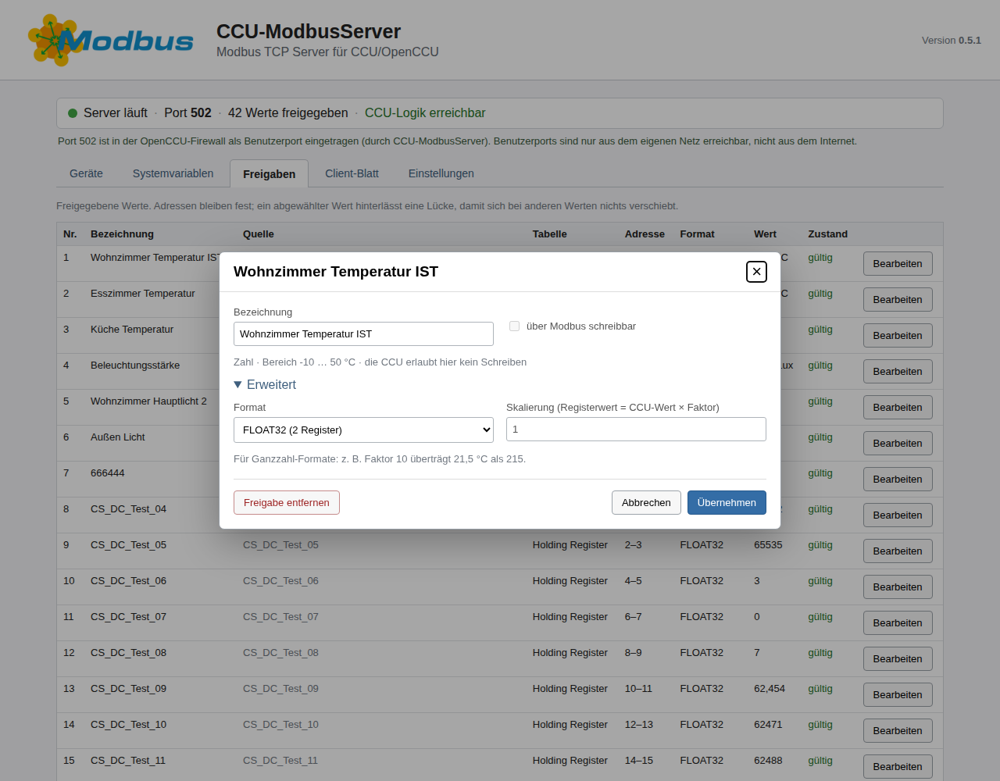
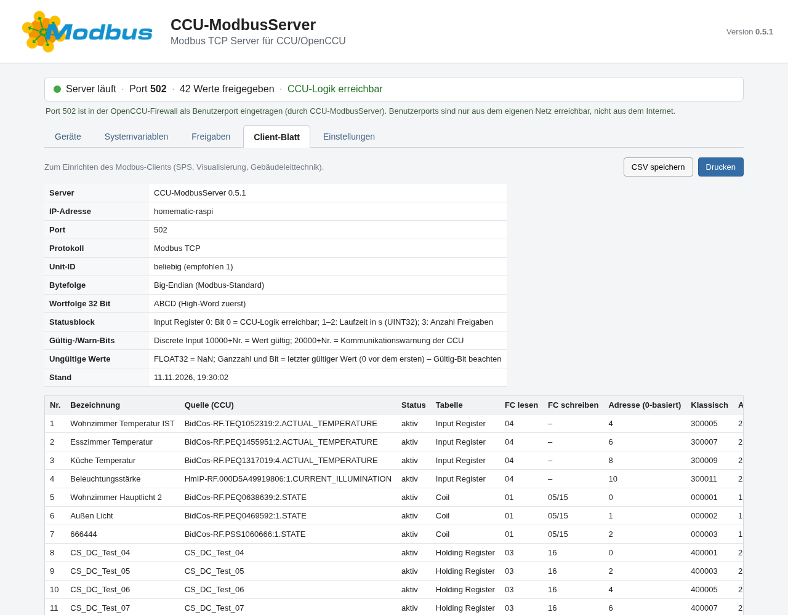
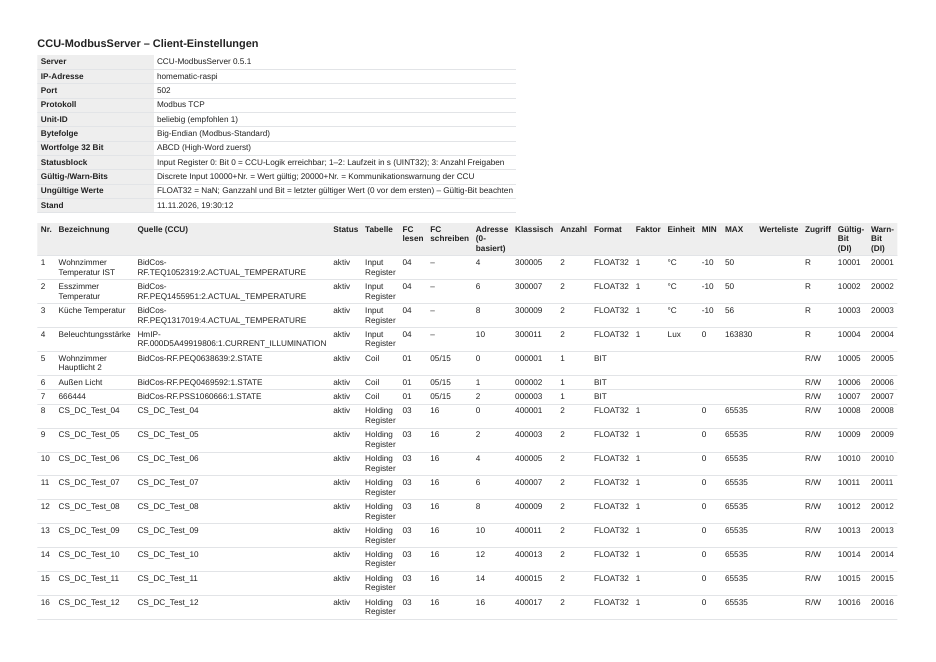
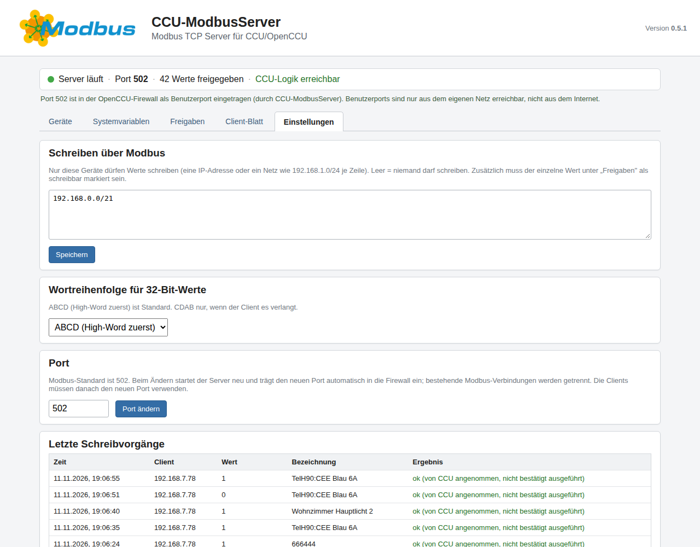

# CCU-ModbusServer

**Modbus-TCP-Server für CCU/OpenCCU** · Version 0.5.1

Eigenständiges Add-on, das Werte einer HomeMatic-Zentrale über **Modbus TCP** bereitstellt:
Datenpunkte von Geräten und Systemvariablen werden für SPS, Visualisierungen und
Gebäudeleittechnik lesbar und – wenn ausdrücklich freigegeben – schreibbar.
Auswahl, Beschriftung und Datenformat kommen aus der CCU; die Registerbelegung für den
Client erzeugt das Add-on selbst, zum Ausdrucken und als CSV.

| | |
|---|---|
| Version | 0.5.1 |
| Plattformen | Linux AMD64, ARM64, ARMv7 (z. B. RaspberryMatic/OpenCCU auf Raspberry Pi) |
| Lizenz | [CCU-ModbusServer-Lizenz 1.1](LICENSE) – kostenlos, auch gewerblich |
| Sprache | Go 1.25, statisch gebaut, keine Fremdbibliotheken |
| Gegenstück | [CCU-ModbusClient](https://github.com/WolfHenk/CCU-ModbusClient) bindet Modbus-Geräte *in* die CCU ein |

---

## ⚠️ Wichtiger Sicherheitshinweis zu Schreibzugriffen

**Über Modbus geschriebene Werte schalten echte Geräte.** Ein Client, der schreiben darf,
kann Licht, Steckdosen, Heizungsventile oder Sollwerte verstellen – auch versehentlich
durch eine falsch eingestellte Registeradresse.

Deshalb ist Schreiben doppelt abgesichert: Ein Wert muss **einzeln als schreibbar
freigegeben** sein **und** der Client muss in der **Liste der schreibberechtigten
Adressen** stehen. Ab Werk darf niemand schreiben.
**Der Anwender trägt die Verantwortung für die von ihm vorgenommenen Freigaben und die
daraus entstehenden Folgen.** Der Autor übernimmt für Schäden durch unsachgemäße
Verwendung oder Konfiguration keine Haftung, soweit gesetzlich zulässig.

---

## Modbus-Begriffe einfach erklärt

| Begriff | Größe | Lesen | Schreiben | Im CCU-ModbusServer |
|---|---|:---:|:---:|---|
| **Coil** | 1 Bit | ✅ | ✅ | schreibbare Logikwerte, z. B. Licht ein/aus, Tastendruck |
| **Discrete Input** | 1 Bit | ✅ | – | nur lesbare Logikwerte, z. B. Fensterkontakt; außerdem Gültig- und Warnbits |
| **Input Register** | 16 Bit | ✅ | – | nur lesbare Zahlen, z. B. Temperatur, Helligkeit; außerdem der Statusblock |
| **Holding Register** | 16 Bit | ✅ | ✅ | schreibbare Zahlen, z. B. Sollwerte, Zahlen-Systemvariablen |

Zahlen mit 32 Bit (INT32, UINT32, FLOAT32) belegen zwei aufeinanderfolgende Register.

---

## Installation

1. Das Archiv `CCU-ModbusServer-<Version>-INSTALL.tar.gz` herunterladen.
2. In der WebUI der CCU: **Einstellungen › Systemsteuerung › Zusatzsoftware**, Datei
   auswählen, **Installieren**. Das Archiv enthält die Programme für alle drei Architekturen;
   die passende wird automatisch gewählt.
3. Nach der Installation startet der Server auf **Port 502** und trägt den Port selbst als
   Benutzerport in die Firewall der CCU ein.

Die Oberfläche öffnet sich unter **Zusatzsoftware › CCU-ModbusServer › Einstellen**.
Sie verlangt eine Anmeldung als Administrator der CCU.

Ein Update wird genauso installiert; Freigaben, Adressen und Einstellungen bleiben erhalten.

---

## Bedienung

Oben zeigt die Seite immer den Zustand: ob der Server läuft, den Port, die Zahl der
Freigaben, ob die CCU-Logik antwortet, und den Firewall-Eintrag. Benutzerports der
OpenCCU-Firewall sind nur aus dem eigenen Netz erreichbar, nicht aus dem Internet.

### 1. Geräte auswählen



Die Auswahl funktioniert wie der Gruppendialog der CCU:

- **Filtern** nach Name, Raum, Gewerk und Gerätetyp; „nur freigegebene" zeigt die aktuelle
  Auswahl.
- Ein Gerät **aufklappen**, dann je Kanal die Datenpunkte mit Typ, Zugriff und aktuellem
  Wert sehen.
- **Häkchen setzen** gibt einen Wert sofort über Modbus frei; die vergebene Adresse
  erscheint rechts daneben (z. B. „Input Register 4").
- Wartungswerte (Batterie, Funkstärke, UNREACH …) liegen eingeklappt unter
  „Servicewerte".
- Zeichenketten werden nicht angeboten (Modbus kennt keinen Text).

### 2. Systemvariablen



Logik-, Zahlen- und Werteliste-Variablen werden wie Datenpunkte angehakt. Interne
Variablen der CCU sind ausgeblendet, lassen sich aber einblenden.

### 3. Freigaben prüfen und anpassen



Alle freigegebenen Werte mit Nummer, Quelle, Modbus-Tabelle, Adresse, Format, aktuellem Wert
und Zustand. **Bearbeiten** öffnet die Einstellungen eines Werts:



- **Bezeichnung** – voreingestellt ist der Name aus der CCU.
- **über Modbus schreibbar** – nur möglich, wenn die CCU den Datenpunkt schreiben lässt.
- **Erweitert › Format** – z. B. FLOAT32 oder eine Ganzzahl (INT16, UINT16, INT32, UINT32).
- **Erweitert › Skalierung** – nur für Ganzzahlen: Registerwert = CCU-Wert × Faktor.
  Beispiel: Faktor 10 überträgt 21,5 °C als 215.

Das Add-on prüft jede Kombination gegen den Wertebereich der CCU und lehnt Formate ab, in
die der Wert nicht passt.

**Adressen bleiben fest.** Neue Freigaben bekommen die nächste freie Adresse. Wird ein Wert
abgewählt, bleibt seine Adresse reserviert (im Client-Blatt als „reserviert" markiert),
damit sich bei anderen Werten nichts verschiebt. Wird er mit gleichem Format wieder freigegeben, bekommt er
seine alte Adresse zurück.

### 4. Client-Blatt – Druck und CSV



Alles, was zum Einrichten des Modbus-Clients nötig ist: IP-Adresse, Port, Unit-ID, Byte- und
Wortfolge, Statusblock und je Wert Tabelle, Funktionscodes, Adresse (0-basiert und
klassisch), Anzahl Register, Format, Faktor, Einheit, Wertebereich, Werteliste, Zugriff
sowie Gültig- und Warnbit.

- **Drucken** erzeugt ein Blatt im Querformat A4; die Kopfzeile wiederholt sich auf jeder
  Seite.
- **CSV speichern** schreibt dieselben Angaben als Tabelle (Semikolon, UTF-8, für Excel
  und LibreOffice).



### 5. Einstellungen



- **Schreiben über Modbus** – IP-Adressen oder Netze (z. B. `192.168.1.0/24`), je Zeile
  eine, die schreiben dürfen. Leer bedeutet: niemand darf schreiben.
- **Wortreihenfolge** für 32-Bit-Werte: ABCD (Standard) oder CDAB.
- **Port** – beim Ändern prüft der Server, ob der Port frei ist, startet neu und trägt den
  neuen Port in die Firewall ein. Startet er mit dem neuen Port nicht, bleibt der alte
  aktiv.
- **Letzte Schreibvorgänge** – wer wann welchen Wert geschrieben hat und was die CCU
  geantwortet hat.

---

## Registerbelegung

### Statusblock (Input Register 0–3)

| Register | Inhalt |
|---|---|
| 0 | Bit 0 = CCU-Logik erreichbar |
| 1–2 | Laufzeit des Servers in Sekunden (UINT32) |
| 3 | Anzahl Freigaben |

Die freigegebenen Zahlenwerte im Input-Register-Bereich beginnen daher bei Register 4.

### Gültig- und Warnbits

Jede Freigabe hat eine feste Nummer *n* (Spalte „Nr.").

| Discrete Input | Bedeutung |
|---|---|
| 10000 + *n* | 1 = Wert gültig (CCU-Logik erreichbar, Wert gelesen und aktuell) |
| 20000 + *n* | 1 = Kommunikationswarnung der CCU für das Gerät (UNREACH oder unbekannt) |

Eine Kommunikationswarnung macht einen zuletzt empfangenen Messwert **nicht** ungültig –
sie ist eine zusätzliche Information.

### Ungültige Werte

| Format | Inhalt, solange das Gültig-Bit 0 ist |
|---|---|
| FLOAT32 | NaN |
| Ganzzahl, Bit | letzter gültiger Wert (0 vor dem ersten) |

### Datenformate

| Typ in der CCU | Standard | Alternativen |
|---|---|---|
| Logik | Bit (Coil oder Discrete Input) | – |
| Tastendruck | Bit (Coil, liest immer 0) | – |
| Zahl | FLOAT32 | INT16, UINT16, INT32, UINT32 mit Skalierung |
| Ganzzahl | INT32 | INT16, UINT16, UINT32, FLOAT32 |
| Werteliste | UINT16 (Index in die Liste) | – |

Byte-Reihenfolge: Big-Endian (Modbus-Standard). Unit-ID: beliebig.

### Funktionscodes und Fehlercodes

| FC | Funktion |
|---|---|
| 01 / 02 | Coils / Discrete Inputs lesen (max. 2000 Bit) |
| 03 / 04 | Holding / Input Register lesen (max. 125 Register) |
| 05 / 15 | Coil / mehrere Coils schreiben |
| 06 / 16 | Holding Register / mehrere Register schreiben |

| Exception | Bedeutung |
|---|---|
| 01 | Client darf nicht schreiben, oder Funktion nicht unterstützt |
| 02 | Adresse nicht belegt, nicht schreibbar, oder ein 32-Bit-Wert nur halb adressiert |
| 03 | Wert ungültig (außerhalb MIN/MAX der CCU, kein Eintrag der Werteliste, NaN) oder Anzahl ungültig |
| 04 | Die CCU hat den Wert nicht angenommen |
| 06 | Derselbe Wert wurde vor weniger als 1 s schon geschrieben – später erneut versuchen |

Ein Schreibbefehl über mehrere Werte wird vollständig geprüft, bevor etwas an die CCU geht.
Schreibt ein Client den Wert, den die CCU bereits hat, wird das quittiert, ohne die CCU zu
belasten. Eine positive Antwort heißt: Die CCU hat den Wert angenommen – ob das Gerät per
Funk geschaltet hat, zeigt der nächste gelesene Wert.

---

## Technische Daten

| | |
|---|---|
| Abfrage der CCU | Standard 1 s (200 ms … 60 s), höchstens 10 % Rechenzeit der CCU-Logik |
| Verbindungen | höchstens 16 gleichzeitig; ruhende Verbindungen werden nach 120 s getrennt |
| Last | geprüft mit 12 Verbindungen unter Volllast über 30 min: 8,9 Mio. Anfragen ohne Fehler, 99 % unter 10 ms, Speicher konstant ca. 12 MB |
| Neustart der CCU | Server startet automatisch und wartet, bis die CCU-Logik bereit ist |
| Zugriffsschutz | Oberfläche nur für CCU-Administratoren; interne Schnittstelle nur auf 127.0.0.1 |

### Konfigurationsdateien

Unter `/usr/local/etc/config/addons/ccu-modbusserver/` (werden mit der CCU-Datensicherung
gesichert):

| Datei | Inhalt |
|---|---|
| `config.json` | `port`, `write_allow`, `poll_interval_ms`, `max_connections`, `only_unit_id` |
| `mapping.json` | Freigaben mit festen Nummern und Adressen – wird von der Oberfläche gepflegt |

Normalerweise ist kein Eingriff nötig; alles Nötige lässt sich in der Oberfläche einstellen.

---

## Deinstallation

**Zusatzsoftware › CCU-ModbusServer › Deinstallieren.** Entfernt Programme, Einstellungen
und den Firewall-Eintrag – diesen nur, wenn ihn das Add-on selbst angelegt hat.

---

## Lizenz in Kürze

- ✅ Private und gewerbliche Nutzung erlaubt
- ✅ Ändern und Weitergeben erlaubt – **nur kostenlos**, mit vollständigem Quellcode und unter
  denselben Bedingungen
- ✅ Arbeitsleistung (Installation, Einrichtung, Support) und Hardware dürfen berechnet werden
- ❌ Kein Entgelt für die Software selbst, auch kein Aufschlag auf Preise oder Stundensätze

Maßgeblich ist der vollständige Text in [LICENSE](LICENSE).

---

## Quellcode

| Pfad | Inhalt |
|---|---|
| `cmd/ccu-modbusserverd/` | Server: Konfiguration, lokale Schnittstelle, Start |
| `internal/modbus/` | Modbus-TCP-Protokoll |
| `internal/rega/` | Zugriff auf die CCU-Logik (ReGa): Geräteliste, Werte, Schreiben |
| `internal/poller/` | zyklische Abfrage der CCU |
| `internal/mapping/` | Freigaben, feste Adressen, Datenformate |
| `internal/engine/` | Registertabelle, Wertequalität, Schreibprüfung, Client-Blatt |
| `internal/quality/` | Gültigkeit, Erreichbarkeit, Empfangsrhythmus |
| `packaging/` | WebUI, Startskript, Firewall- und Installationsskripte |
| `tools/` | Prüfwerkzeuge (Modbus-Gegentest, Lasttest, Oberflächen- und Skripttests) |

## Bauen (Linux)

```sh
make test      # Formatprüfung, vet, Tests mit Race-Detector, Skript- und Oberflächentests
make package   # Programme für AMD64/ARM64/ARMv7, INSTALL- und SOURCE-Archiv unter build/
```

Benötigt Go 1.25 und für die Oberflächentests Node.js.

---

## Marken

Modbus ist eine Marke der jeweiligen Rechteinhaber. HomeMatic, CCU und OpenCCU sind Marken bzw.
Bezeichnungen ihrer jeweiligen Inhaber. Dieses Projekt ist von ihnen weder zertifiziert noch
unterstützt.

---

© 2026 Wolfram Henkel
